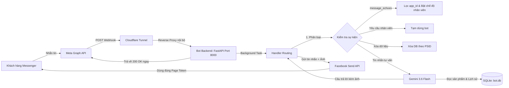

# Kiến trúc Hệ thống Chatbot Facebook Messenger Đa Fanpage

Hệ thống được thiết kế theo tiêu chí: **Nhẹ, Tối giản, Bảo mật và Dễ mở rộng**. Toàn bộ dịch vụ chạy trọn vẹn trên một máy chủ ảo (VPS) Ubuntu cấu hình cơ bản (1 vCPU, 1–2GB RAM).

---

## 1. Sơ đồ luồng dữ liệu tổng thể

---

## 2. Các thành phần chính

### 2.1. Webhook Ingestion (`main.py`)
- **FastAPI** xử lý bất đồng bộ cực nhanh.
- `GET /webhook`: Tiếp nhận `hub.challenge` từ Meta để xác thực webhook khi cài đặt.
- `POST /webhook`: 
  - Xác thực chữ ký `X-Hub-Signature-256` bằng App Secret qua HMAC-SHA256 để chống giả mạo.
  - **Trả về `HTTP 200 OK` ngay lập tức** trong dưới 1 giây để đáp ứng yêu cầu khắt khe của Meta (timeout 20s).
  - Đẩy toàn bộ xử lý vào Background Task (`asyncio.create_task`).
- **Tự động dò tìm Page ID (Auto-Discovery):** Trong `lifespan`, bot tự động gọi `GET /me` với Meta để lấy Page ID cho bất kỳ Page Access Token nào trong `.env`.

### 2.2. Định tuyến Đa Fanpage & Sự kiện (`handler.py`)
- **Multi-Tenant:** Tách biệt và quản lý độc lập nhiều Fanpage trên cùng 1 server bot.
- **Chống lặp tin:** Dùng bộ nhớ đệm `_seen_mids` (10,000 ID gần nhất) để loại bỏ các gói tin gửi lại từ Meta.
- **Xử lý `message_echoes` thông minh:**
  - Nếu `app_id == APP_ID`: Bỏ qua (vì đây là echo do chính bot gửi).
  - Nếu do nhân viên gửi từ Meta Business Suite: Tạm dừng bot cho khách hàng đó (`_human_mode` theo cặp `(page_id, psid)`). Khách gõ *"bot"* để kích hoạt lại.
- **Hỗ trợ gửi ảnh sản phẩm:** Tự động phát hiện cú pháp `[IMAGE: url]` từ AI để gửi ảnh đính kèm chất lượng cao qua Send API.

### 2.3. Trí tuệ Nhân tạo (`ai.py`)
- Sử dụng SDK chính thức mới nhất: `google-genai`.
- Model chính `gemini-3.6-flash`, model dự phòng `gemini-3.5-flash` (khai báo trong `_MODELS`). Mỗi model có hạn giờ riêng (13 giây rồi 10 giây); quá hạn hoặc gặp lỗi tạm thời (404/429/500/503/504) thì chuyển model kế tiếp.
- `max_output_tokens = 4096`: hạn mức này tính cả token "suy nghĩ"; đặt thấp (800) từng làm câu trả lời bị cắt cụt và mất thẻ `[IMAGE: ...]` (xem FAQ mục 5).
- Dữ liệu sản phẩm và kịch bản lấy từ Google Sheet qua `kb.py` (tab `prompt`, `data`, `knowledge`, chỉ dòng `APPROVED`), đồng bộ mỗi `KB_REFRESH_SECONDS`. Không có `SHEET_ID` thì dùng `products.json`. Dữ liệu dưới `KB_FULL_CONTEXT_CHARS` ký tự được đưa trọn vào prompt, lớn hơn thì truy xuất theo từng câu hỏi.
- Prompt giới hạn chặt chẽ (Strict Guardrail): Chỉ trả lời dựa trên danh mục sản phẩm trong kho tri thức, không tự bịa sản phẩm hay giá bán, hướng dẫn chốt đơn COD và ghi nhận thông tin đơn.
- Tổng thời gian gọi AI không quá 25 giây (`_TIMEOUT`), sau đó trả lời dự phòng (Fallback) để vẫn trong luật 30 giây của Meta.
- Mỗi lượt ghi log `Gemini xong: model=..., X.Xs, finish=..., token đầu ra=...` để đo độ trễ từng model.

### 2.4. Lưu trữ Dữ liệu (`database.py`)
- **SQLite** thuần không cần cài đặt thêm daemon dịch vụ:
  - Bảng `users`: Lưu thời gian khách bắt đầu nhắn.
  - Bảng `conversations`: Lưu ngữ cảnh 8 lượt chat gần nhất để AI hiểu ngữ cảnh.
  - Bảng `orders`: Lưu trữ đơn hàng khi khách chốt đơn.
- Tuân thủ chính sách bảo mật: Hỗ trợ hàm `delete_user(psid)` xóa sạch mọi dữ liệu khi khách yêu cầu.

### 2.5. Hạ tầng Mạng (`cloudflared`)
- Kết nối thông qua **Cloudflare Tunnel**:
  - Không cần mở bất kỳ cổng nào trên Firewall máy chủ (đóng toàn bộ port 80, 443).
  - Tự động mã hóa HTTPS với chứng chỉ SSL của Cloudflare.
  - Chống tấn công DDoS và ẩn hoàn toàn địa chỉ IP thật của VPS.
